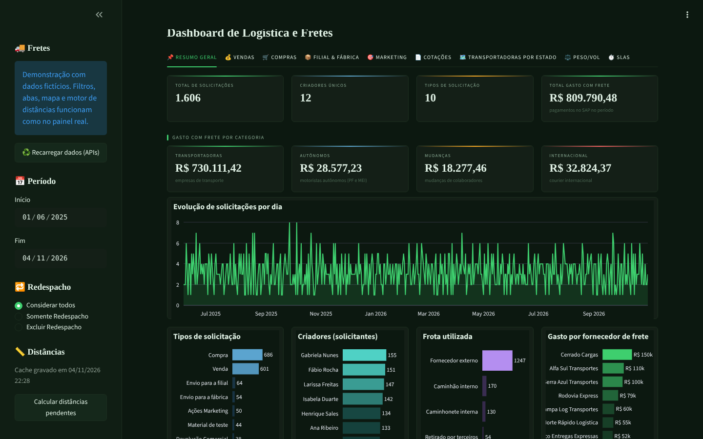
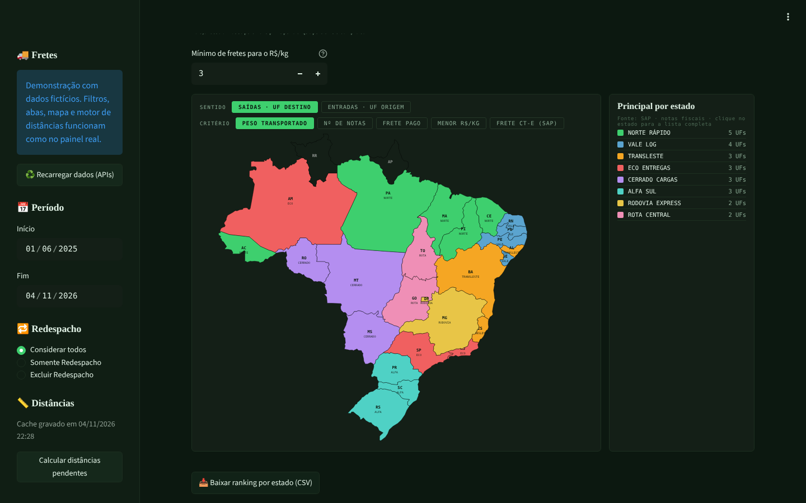

# Logistics and freight dashboard

[🇧🇷 Português](README.md) | 🇺🇸 English

**▶️ [Open the live demo](https://joao-2003.github.io/logistics-freight-dashboard/)**: the actual Streamlit app running in the browser (Pyodide + stlite) with fictitious data. Nothing to install; the first load takes 20 to 60 seconds.

Streamlit dashboard that combines freight requests and quotes from **Pipefy**, invoices, freight bills (CT-e) and payments from **SAP S/4HANA**, and route distances (**OpenStreetMap + OSRM**) to track how much the company spends on freight, with whom, where to, and how efficiently.

> Built by me for the Logistics team of a Brazilian manufacturer and used in production. This repository contains the code without credentials, IDs or real names of sites, carriers or people; the demo uses data invented by `tools/gerar_dados_demo.py`. The interface is in Portuguese.



## What it shows

| Tab | Content |
|---|---|
| Resumo Geral (summary) | Requests, requesters, fleet used and **total freight spend** paid in SAP, split into carriers, independent drivers, relocations and international |
| Vendas · Compras (sales · purchases) | Shipment value, freight paid (CT-e) and freight as % of shipment value; modality, customers, suppliers, cities and states |
| Filial & Fábrica (branches & plant) | Transfers between sites, shipments to the plant and customer returns, with the main flows |
| Marketing | Promotional shipments, own fleet vs. carriers |
| Cotações (quotes) | Freight/shipment ratio, savings (highest quote − selected), deviation of the billed CT-e over the quote (green, yellow, red) and R$/km ranking |
| Transportadoras por Estado (carriers by state) | Map of Brazil with the leading carrier in each state by 5 criteria (weight, invoices, freight paid, lowest R$/kg and SAP CT-e); hover shows the leader, click opens the full list |
| Peso/Vol (weight/volume) | Cost per kg·km and per volume·km, by carrier and packaging type |
| SLAs | Cards stuck per phase, average time per step and overdue cards |



## How the data fits together

1. **Pipefy (GraphQL, paginated):** freight request cards and the quotes table. Two fields with the same label (the start form's "Valor da Remessa:" and a later phase's "Valor da remessa") are merged instead of one overwriting the other, which is what zeroed the purchase, branch and plant KPIs.
2. **SAP S/4HANA (OData v2 and v4, paginated with retries):** billing (weight and volumes per order), supplier line items (payments, posting key 25) and the freight report (invoices and CT-e with partner and state).
3. **Total freight spend:** sums payments to the suppliers in a categorized list (`fornecedores_frete_exemplo.csv`). The old rule, matching names that look like "transport", included non-freight suppliers and missed independent drivers.
4. **Distance engine (`motor_distancias.py`):** Nominatim turns city and state into coordinates and OSRM returns the road distance, cached in Excel. Only successes are cached, company sites have fixed coordinates, and if an API asks to slow down (403/429) the run stops and resumes next time. `atualizar_distancias.py` runs daily from a timer, so it no longer depends on someone opening the dashboard.

## Demo

Without credentials the dashboard switches to demo mode and reads the `demo/` folder. In the browser, the **Calcular distâncias pendentes** button runs the same engine offline: coordinates come from `demo/cidades.csv` and road distance is the straight line × 1.27.

```bash
python tools/gerar_dados_demo.py   # rebuild the fictitious data
```

## Running

```bash
pip install -r requirements.txt
cp .streamlit/secrets.toml.example .streamlit/secrets.toml   # fill in (or leave empty for the demo)
streamlit run Dashboard.py
python atualizar_distancias.py                                # daily distance run
```

## Tech

Python 3 · Streamlit · pandas · Plotly · requests · Pipefy GraphQL · SAP S/4HANA OData · OpenStreetMap Nominatim · OSRM · stlite/Pyodide · systemd timer

## Author

João Victor Guidi de Lima · [LinkedIn](https://www.linkedin.com/in/joão-lima-8b512) · [GitHub](https://github.com/Joao-2003)
