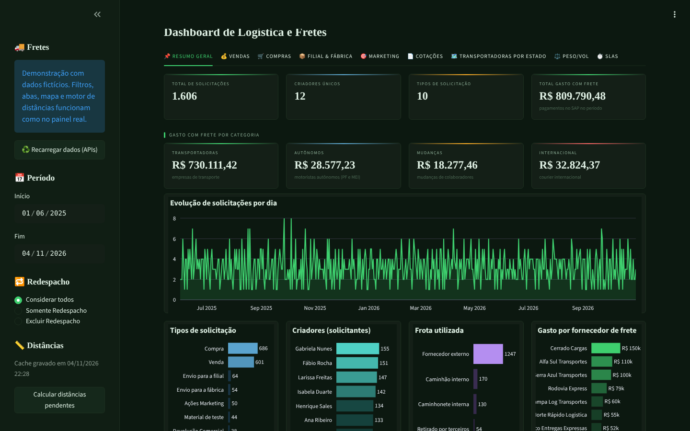
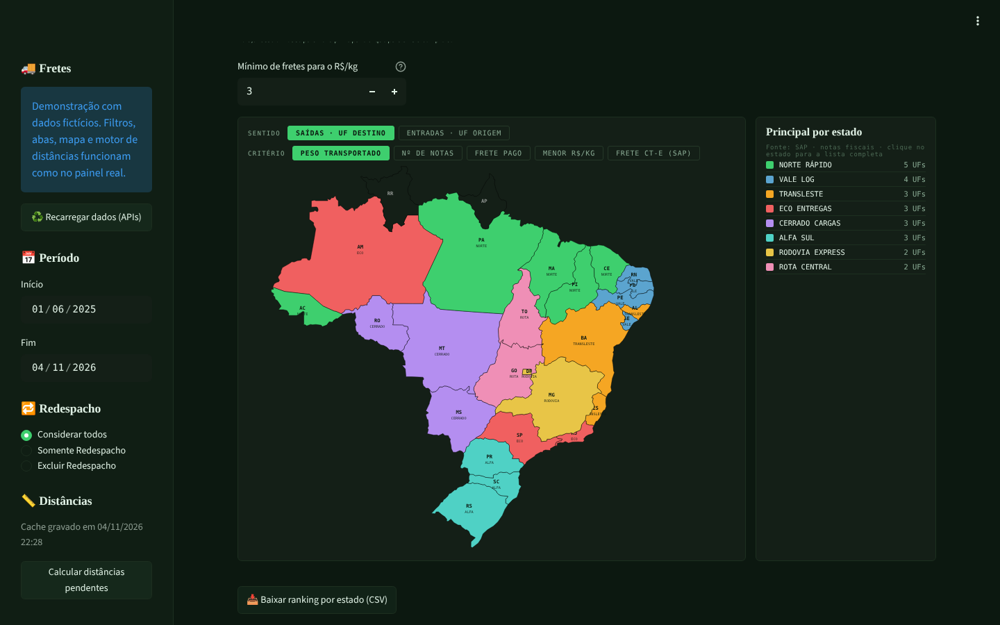

# Dashboard de logística e fretes

🇧🇷 Português | [🇺🇸 English](README.en.md)

**▶️ [Abrir a demonstração](https://joao-2003.github.io/logistics-freight-dashboard/)**: o próprio app Streamlit rodando no navegador (Pyodide + stlite), com dados fictícios. Não precisa instalar nada; a primeira carga leva de 20 a 60 segundos.

Painel em Streamlit que reúne as solicitações e cotações de frete do **Pipefy**, as notas fiscais, os CT-e e os pagamentos do **SAP S/4HANA** e as distâncias das rotas (**OpenStreetMap + OSRM**), para acompanhar quanto a empresa gasta com frete, com quem, para onde e com que eficiência.

> Desenvolvido por mim para a área de Logística de uma indústria brasileira e usado em produção. Este repositório traz o código sem credenciais, IDs, nomes de unidades, transportadoras ou pessoas reais; a demonstração usa dados inventados por `tools/gerar_dados_demo.py`.



## O que mostra

| Aba | Conteúdo |
|---|---|
| Resumo Geral | Solicitações, solicitantes, frota usada e **Total Gasto com Frete** pago no SAP, separado em transportadoras, autônomos, mudanças e internacional |
| Vendas · Compras | Valor da remessa, frete pago (CT-e) e % do frete sobre a remessa; modalidade, clientes, fornecedores, cidades e UFs |
| Filial & Fábrica | Transferências entre unidades, envios para a fábrica e devoluções comerciais, com os principais fluxos |
| Marketing | Envios de material promocional, frota própria × terceiros |
| Cotações | Frete/remessa, saving (maior cotação − selecionada), desvio do CT-e cobrado sobre a cotação (verde, amarelo, vermelho) e ranking por R$/km |
| Transportadoras por Estado | Mapa do Brasil com a principal transportadora de cada UF por 5 critérios (peso, notas, frete pago, menor R$/kg e CT-e do SAP); passar o mouse mostra a líder, clicar abre a lista completa |
| Peso/Vol | Custo por kg·km e por volume·km, por transportadora e tipo de volume |
| SLAs | Cards parados por fase, tempo médio em cada etapa e cards vencidos |



## Como os dados se juntam

1. **Pipefy (GraphQL, paginado):** cards de solicitação de frete e a tabela de cotações. Dois campos com o mesmo rótulo ("Valor da Remessa:" do formulário inicial e "Valor da remessa" de uma fase) são unidos em vez de um sobrescrever o outro; foi isso que zerava os KPIs de compras, filial e fábrica.
2. **SAP S/4HANA (OData v2 e v4, paginado com novas tentativas):** faturamento (peso e volumes por pedido), partidas de fornecedor (pagamentos, chave 25) e o relatório de frete (notas e CT-e com parceiro e UF).
3. **Total gasto com frete:** soma os pagamentos aos fornecedores de uma lista com categoria (`fornecedores_frete_exemplo.csv`). A regra antiga, por nome parecido com "transporte", somava quem não era frete e deixava de fora motoristas autônomos.
4. **Motor de distâncias (`motor_distancias.py`):** Nominatim converte cidade e UF em coordenadas e o OSRM devolve a distância de estrada, com cache em Excel. Só sucessos ficam guardados, as unidades da empresa têm coordenadas fixas e, se a API pedir para parar (403/429), a rodada para e continua na próxima. `atualizar_distancias.py` roda todo dia por um timer, sem depender de alguém abrir o painel.

## Demonstração

Sem credenciais, o painel entra sozinho no modo demonstração e lê a pasta `demo/`. No navegador, o botão **Calcular distâncias pendentes** usa o mesmo motor, só que sem rede: as coordenadas vêm de `demo/cidades.csv` e a distância de estrada é a linha reta × 1,27.

```bash
python tools/gerar_dados_demo.py   # recria os dados fictícios
```

## Como executar

```bash
pip install -r requirements.txt
cp .streamlit/secrets.toml.example .streamlit/secrets.toml   # preencha (ou deixe vazio para a demo)
streamlit run Dashboard.py
python atualizar_distancias.py                                # rodada diária das distâncias
```

## Arquivos

| Arquivo | Função |
|---|---|
| `Dashboard.py` | O painel (abas, KPIs, gráficos e tema escuro) |
| `fontes.py` | Leitura do Pipefy e do SAP, limpeza de nomes e números, modo demonstração |
| `motor_distancias.py`, `atualizar_distancias.py` | Distâncias por rota e a rodada diária |
| `mapa_estados.py`, `mapa_brasil.json` | Aba Transportadoras por Estado (SVG do Brasil + JS) |
| `config.py` | Credenciais, caminhos, unidades com coordenadas e agrupamento de nomes de transportadoras |
| `index.html` | Página da demonstração (stlite) |

## Tecnologias

Python 3 · Streamlit · pandas · Plotly · requests · Pipefy GraphQL · SAP S/4HANA OData · OpenStreetMap Nominatim · OSRM · stlite/Pyodide · systemd timer

## Autor

João Victor Guidi de Lima · [LinkedIn](https://www.linkedin.com/in/joão-lima-8b512) · [GitHub](https://github.com/Joao-2003)
